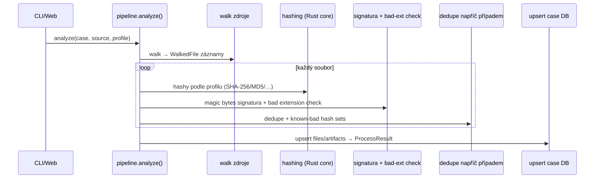
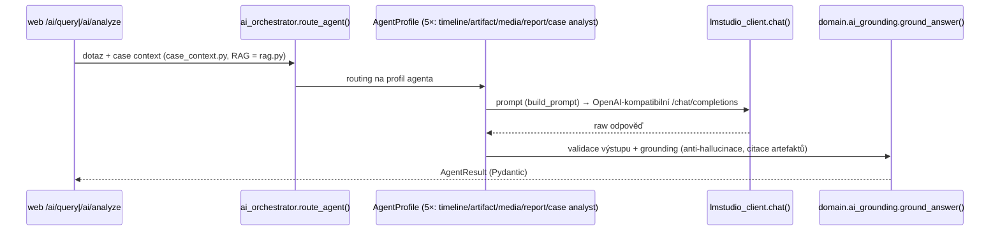
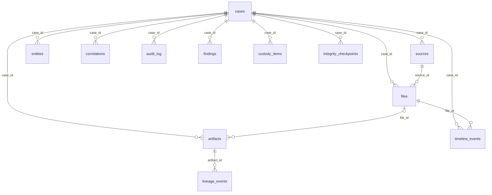

# STOPA — System Blueprint & Architecture Specification

> **Hand-off dokument pro AI agenty** — dokážeš z něj okamžitě refaktorovat, rozšiřovat, dělat security review a generovat dokumentaci bez dalšího zkoumání kódu.
> Vytvořeno: 2026-11-11 · Commit základny: `aa7a60a` (main) · Cesta: `/home/ai/Prace/projekty/stopa`

## 📑 Obsah
- [0. Executive Summary & Metadata](#0--executive-summary--metadata)
- [1. Cíl, Kontext a Architektura](#1--cíl-kontext-a-architektura)
- [2. Struktura Projektu a Moduly](#2--struktura-projektu-a-moduly)
- [3. Datový Tok a Klíčové Procesy](#3--datový-tok-a-klíčové-procesy)
- [4. Datová Vrstva a Schéma](#4--datová-vrstva-a-schéma)
- [5. Integrace a Rozhraní](#5--integrace-a-rozhraní)
- [6. Bezpečnost a Autorizace](#6--bezpečnost-a-autorizace)
- [7. Deployment, Infrastruktura a CI/CD](#7--deployment-infrastruktura-a-cicd)
- [8. Testování](#8--testování)
- [9. Observability a Diagnostics](#9--observability-a-diagnostics)
- [10. Performance](#10--performance)
- [11. Architektonické Rozhodnutí (ADR)](#11--architektonická-rozhodnutí)
- [12. Tech Debt & Risika](#12--tech-debt--risika)
- [13. AI-Agent Handoff Notes](#13--ai-agent-handoff-notes)
- [14. Glosář](#14--glosář)

---

## 0. 📋 EXECUTIVE SUMMARY & METADATA

**One-liner:** STOPA je unifikovaná forenzní workbench (AXIOM + UFED/Inseyets + X-Ways + Belkasoft X + FTK v jednom) — Python CLI + FastAPI web GUI + Rust core pro hashing/carving.

| Metrika | Hodnota |
|---|---|
| LOC (Python src) | 48 714 řádků / 180 souborů |
| LOC (testy) | 33 132 řádků / 123 test_*.py |
| LOC (JS/HTML/CSS web SPA) | ~3 183 řádků |
| LOC (Rust core, PyO3) | 392 (`rust/src/lib.rs`) |
| Extraktory artefaktů | **89** (`src/stopa/artifacts/*.py`) |
| Doménové moduly | 47 (`src/stopa/domain/*.py`) |
| Data vrstva | 27 (`src/stopa/data/*.py`) |
| Web API endpointy | ~50 (viz §5) |
| CLI komandy | ~31 (viz §3.6) |
| Verze | 1.0.0 · `main` @ `aa7a60a` · čistý working tree |
| Stav projektu | **production-grade** (Fáze 2 probíhá — F2.1/F2.2 hotové, dále F2.3 dedup) |

**Rychlá navigace:**
- Entry point CLI: `src/stopa/cli.py` (`main()`, `pyproject.toml` → `stopa = "stopa.cli:main"`)
- Entry point web: `src/stopa/web/app.py` (FastAPI `create_app()`)
- Jediný analytický entrypoint: `src/stopa/pipeline.py` (`analyze()` — sdílený CLI i web)
- Schéma DB: `src/stopa/data/schema.py` (`SCHEMA_VERSION = 14`) + `migrations.py`
- Konfigurace: `pyproject.toml`, env `STOPA_LMSTUDIO_URL` (AI), `.dockerignore`
- Testy: `tests/` (2 469 collected, offline — žádné sítě)

**Jazyky:** Python ≥3.10 (~85 %), JavaScript ES6 SPA (~12 %), Rust/PyO3 (2 %, `rust/src/lib.rs`), HTML/CSS.

## 1. 🎯 CÍL, KONTEXT A ARCHITEKTURA

**Účel:** Forenzní analýza digitálních důkazů — diskové obrazy (EWF/E01, raw), mobilní extrakty (UFED/Inseyets), cloud exporty (Google Takeout, iCloud, WhatsApp), paměť, PCAP — v jednom offline nástroji s reprodukovatelným audit trail.

**Persony:** Forenzní analytik / FDE (primary), AI agent pro automatizovanou analýzu (secondary — viz `STOPA_AI_GOVERNANCE.md`).

### Technologický stack (přesné verze z `pyproject.toml`)
| Komponenta | Verze | Pozn. |
|---|---|---|
| Python | ≥3.10 (venv `.venv` na 3.13) | requires-python |
| pydantic | ≥2.5 | výstupní modely, validace |
| regipy | ≥6 | Windows registry hive parser |
| rich | ≥13 | CLI progress bary (lazy import) |
| fastapi / uvicorn[standard] | ≥0.115 / ≥0.30 | optional `[web]` |
| httpx | ≥0.27 | LM Studio klient + Plaso upload |
| cryptography | ≥42 | optional `[fde]` — AES-256-CBC FDE dešifrování |
| pytsk3 | ≥20260715 | optional `[tsk]` — nativní TSK bindingy (primární backend, fallback CLI binárky) |
| duckdb | ≥1.0 | optional `[analytics]` — F2.2 OLAP vrstva |
| scapy | ≥2.5 | optional `[net]` — PCAP/TCP reassembly/IoC |
| openpyxl / Pillow / weasyprint | ≥3.1 / ≥10 / ≥62 | optionals: iMessage XLSX, EXIF, PDF reporty |
| pytest / ruff | ≥8 / ≥0.4 | dev |
| Rust + PyO3 | `rust/src/lib.rs` (392 řádků) | one-pass hashing + Aho-Corasick carving scan (`data/rust_core.py`) |

### Architektura — **layered monolith s čistým jádrem** (nikoli hexagonalní, nikoli microservices)
```mermaid
graph TD
    CLI[cli.py — argparse, ~31 komand] --> PIPE[pipeline.py :: analyze() — JEDINÝ analytický entrypoint]
    WEB[web/app.py — FastAPI, ~50 endpointů] --> PIPE
    PIPE --> ART[artifacts/ — 89 extraktorů artefaktů]
    PIPE --> DOM[domain/ — 47 modulu čistá logika bez I/O]
    ART --> DOM
    DOM --> DATA[data/ — repositories, SQLite, TSK, DuckDB, LM Studio klient]
    WEB --> INTEL[intelligence/ — multi-agent AI orchestrace]
    INTEL --> DOM
    PRESENT[presentation/case_report.py] --> DOM
```
- **Pravidlo závislostí:** `artifacts` a `web` → `domain` (čistá logika, bez I/O) → `data` (všechna I/O). `pipeline.py` je jediný bod, kde se schází CLI i web — „jedna cesta k debugování" (`src/stopa/pipeline.py:1-9`).
- **Modulární mapa:** viz §2. Acykličnost ověřena importem (domain neimportuje data/web/cli mimo injektované callables).

### Non-functional requirements (vyčteno z kódu)
- **Offline-first:** žádná povinná síť; AI volitelná přes lokální LM Studio (`data/lmstudio_client.py`).
- **Graceful degradation** všude: bez `duckdb` → SQLite fallback, bez `scapy` → statický PCAP scanner, bez `pytsk3` → CLI TSK binárky, bez LM Studio → `available=False`, ne výjimka.
- **Reprodukovatelnost:** audit trail (hash-chain v `audit_log`), integrity checkpoints, lineage events — viz §6 a `domain/reproducibility.py`.
- **Testovatelnost:** celá `intelligence/` testuje bez spuštěného LM Studio (IO injektováno jako callable).

## 2. 📁 STRUKTURA PROJEKTU A MODULY

```
stopa/
├── pyproject.toml        # manifest, verze, optionals, ruff + pytest config
├── rust/src/lib.rs       # Rust core (PyO3): hashing + carving scan
├── src/stopa/            # ★ hlavní package
│   ├── __main__.py       # python -m stopa → cli.main()
│   ├── cli.py            # 2 976 řádků, argparse, ~31 komand (viz §3.6)
│   ├── pipeline.py       # 1 399 řádků — analyze(), FTK-style processing
│   ├── models.py         # Pydantic modely sdílené CLI/web
│   ├── installer.py      # instalace nativních závislostí (EWF/TSK)
│   ├── sandbox_worker.py # izolovaný worker (FDE dešifrování apod.)
│   ├── artifacts/        # 89 extraktorů — jeden soubor = jeden artefakt
│   │                     #   PARSER_VERSION + is_*_file() + extract_*_artifacts()
│   ├── domain/           # 47 modulů ČISTÁ logika bez I/O (viz §2.1)
│   ├── data/             # 27 modulů VŠECHNA I/O: SQLite, TSK, DuckDB, LM Studio
│   ├── intelligence/     # AI multi-agent engine (5 agentů + orchestrátor + RAG)
│   ├── presentation/     # case_report.py — report rendering
│   └── web/              # app.py (FastAPI) + static/ (vanilla JS SPA, 14 komponent)
├── tests/                # 123 test_*.py, 2 469 collected, offline
├── .github/workflows/    # ci.yml (lint+testy+pip-audit), release.yml
├── Dockerfile            # multi-stage, image < 1.5 GB AK
├── docs/                 # AI_ARCHITECTURE apod. + TENTO dokument
└── STOPA_*.md            # ROADMAP, CHANGELOG (97 kB!), SECURITY_REPORT, TECHNICAL_AUDIT, COVERAGE_MATRIX.csv
```

### 2.1 Modulární mapa — domain/ (47 modulů, čistá logika)
| Skupina | Moduly |
|---|---|
| Forenzické jádro | `hashing`, `carving`, `sqlite_carver/formatter/parser/recover`, `dedupe`, `bad_extension`, `integrity`, `lineage` |
| FDE dešifrování | `fde`, `fde_bitlocker`, `fde_fbe`, `fde_luks` |
| Forenzika domén | `mem_forensics`, `mobile_forensics`, `net_forensics`, `anti_forensics`, `plaso_import`, `timesketch_push` |
| Inteligence | `correlation`, `entities`, `entity_resolution`, `timeline_intel`, `timeline_anomaly`, `ai_assistant`, `ai_grounding` (grounding = anti-hallucinace) |
| Export & reporty | `export`, `export_schedule`, `report`, `pii_redaction` |
| Governance | `rbac`, `profiles`, `reproducibility`, `validation_registry`, `benchmark`, `evidence_model`, `uco`, `i18n`, `times`, `file_meta`, `file_preview`, `image_types`, `signatures`, `search_filters` |

### 2.2 data/ (27 modulů, všechna I/O)
`db.py` (SQLite connect), `schema.py` (DDL v14), `migrations.py` (6 migrací viz §4), repositories: `case/file/artifact/entity/audit_repository`; TSK: `tsk.py`(API)+`tsk_py.py`(pytsk3 bindingy)+`tsk_cli.py`(fallback binárky)+`tsk_types.py`; DuckDB: `analytics.py`; AI: `lmstudio_client.py`; ostatní: `ingest`, `image_pipeline`, `ewf_container`, `bde_fvde`, `pcap_io`, `volatility`, `benchmark_engine`, `diagnostics`, `validation_report`, `timesketch_client`, `rust_core.py`.

### 2.3 Konvence
- **Feature-first v artifacts/** (jeden soubor = jeden artefakt, `PARSER_VERSION` konstanta pro reprodukovatelnost), **type-first v domain/data** (vrstvy).
- Public API: `stopa.intelligence.__init__` exportuje `AGENTS`, `AgentProfile`, orchestrátor; ostatní moduly importují přímo (žádné barrel files mimo package init).

## 3. 🔄 DATOVÝ TOK A KLÍČOVÉ PROCESY

### 3.1 Jak data přicházejí
CLI (`stopa add <zdroj> --case X`), web upload/POST `/api/cases/{id}/sources`, Plaso CSV import (multipart upload), UFED/Inseyets extrakty, cloud exporty jako soubory. **Queue/broker: NEEXISTUJE** — zpracování je synchronní v `analyze()` s `ThreadPoolExecutor` (`pipeline.py`).

### 3.2 Jádrowý pipeline (`src/stopa/pipeline.py::analyze()`)


### 3.3 Extrakce artefaktů — dispatch v `pipeline.py`
89 extraktorů se registruje importem; každý má `is_*_file()` (detekce) + `extract_*_artifacts()` (výstup = Pydantic modely). Výsledky → tabulka `artifacts`.

### 3.4 Timeline & analytics (F2.2, commit `aa7a60a`)
`data/analytics.py`: DuckDB **ATTACH** SQLite case DB + materiálové tabulky vedle (`case-XXX.db` → `case-XXX.duckdb`), staleness signatura pro invalidaci. AK: range 1h/10M eventů = 0.03 s, agregace 0.006 s.

### 3.5 Error handling
- **Retry:** žádné retry mechanismy v jádru (offline nástroj). DLQ: NEEXISTUJE (`⚠️ NENALEZENO`).
- **Idempotency:** upserty do case DB + `PARSER_VERSION` na artefaktech → re-run je idempotentní.
- **Sandbox:** `sandbox_worker.py` izoluje rizikové operace (FDE dešifrování).
- Graceful degradation viz §1; výjimky jsou typované per-doména (`TskError`, `AnalyticsError`, `LmStudioUnavailable`, `OrchestrationError`).

### 3.6 CLI komandy (~31, `src/stopa/cli.py`)
`case new/auto-export/auto-interval`, `add`, `files`, `stats`, `search`, `timeline`, `correlate`, `analytics`, `image`, `mobile`, `decrypt`, `memory-analyze`, `import-mobile`, `pcap-analyze`, `antiforensics`, `profiles`, `report`, `export`, `plaso-import`, `timesketch-push`, `verify`, `integrity`, `replay`, `benchmark`, `validate`, `analyze`, `audit`, `backup`, `serve`, `install`.

### 3.7 Stavy případu (state machine)
`⚠️ NEZNÁMO — explicitní state machine v kódu neexistuje`; stavy jsou implicitní přes tabulku `cases` + `analysis_operations` (běžící/ukončené operace).

### 3.8 AI multi-agent flow (`intelligence/`)


## 4. 🗄️ DATA VRSTVA A SCHEMA

**Primární store:** SQLite, jeden DB soubor na případ (`case-XXX.db` v workspace); DuckDB vedle pro OLAP (§3.4). In-memory: žádné (⚠️ NENALEZENO — cache jen v procesu).

**SCHEMA_VERSION = 14** (`src/stopa/data/schema.py:13`). Migrace: `src/stopa/data/migrations.py` — up-only, `_schema_version(conn) < SCHEMA_VERSION → ALTER` (24 migracních kroků). Rollback: NEEXISTUJE (`⚠️ NENALEZENO`) — konvence „verze nahoru jen".

### 4.1 ER diagram (hlavní entita a relace, `schema.py`)



15 tabulek: `cases, sources, files, artifacts, timeline_events, entities, correlations, meta, evidence_marks, audit_log, findings, lineage_events, integrity_checkpoints, analysis_operations, custody_items`.

### 4.2 Indexy (výběr, `schema.py`)
`idx_files_source`, `idx_files_sha256` (dedupe), `idx_artifacts_{source,ts,type,file}`, `idx_timeline_{ts,source}` (timeline = kritická cesta), `idx_entities_case`, `idx_correlations_case`, `idx_audit_ts`, `idx_findings_{case,kind}`, `idx_lineage_{case,op}`, `idx_ops_{case,type}`.

### 4.3 FK a constraints
`REFERENCES`: cases(6×), sources(4×), files(3×), artifacts(1×). **Pozor (známý pitfall):** `timeline_events.artifact_id` nemá `ON DELETE` — při výměně artefaktů volat `clear_timeline` PŘED replace, jinak dangling FK.

### 4.4 Artefaktové schémata
Každý extraktor vrací **Pydantic modely** (`src/stopa/models.py`) — typová validace na hranici parseru; `PARSER_VERSION` u artefaktu pro idempotentní re-run. JSON Schema: NENALEZENO (Pydantic = de-facto schéma, `.model_dump()` → řádky).

### 4.5 Retention
Žádné automatické čištění/archivace v jádru (`⚠️ NENALEZENO`); `stopa backup` + `audit_log`/`lineage_events` slouží jako retenční záznam (chain of custody).

## 5. 🔌 INTEGRACE A ROZHRANÍ

| Integrace | Typ | Kde v kódu | Poznámka |
|---|---|---|---|
| LM Studio (OpenAI-kompatibilní API) | REST `http://localhost:1234/v1` | `data/lmstudio_client.py`, web `/api/cases/{id}/ai/*` (`web/app.py:1621,1670`) | Env `STOPA_LMSTUDIO_URL`; nedostupnost → HTTP 503, nikdo nečeká navěky |
| Timesketch | REST push | `data/timesketch_client.py`, `/timesketch-push` (app.py:1350) | Export timeline do externí vizualizace |
| Plaso | CLI import | `/plaso-import` + multipart upload (app.py:1469) | Import plaso DB jako zdroj |
| libyal (libewf/libafflib/libcommon) | **ctypes .so** | `data/ewf_container.py`, env `STOPA_EWF_LIB` | Build z github master (`--depth 1`) v Docker stage 1 — ⚠️ nepinuje release tag |
| TSK (The Sleuth Kit) | `pytsk3` bindingy → fallback CLI binárky | `data/tsk_py.py`, `tsk_cli.py`, `tsk_types.py` | `tsk_py.py` má ruff per-file-ignores BLE001/S110 — idiom robustního walku |
| scapy | lazy import | PCAP parser + TCP reassembly (F1.3) | Bez scapy → statický scanner fallback |
| DuckDB | lazy import | `data/analytics.py` | Bez duckdb → SQLite fallback |

**Volitelné extras** (`pyproject.toml [project.optional-dependencies]`): `pdf`=weasyprint, `web`=fastapi+uvicorn+httpx+multipart, `fde`=cryptography (AES-256-CBC mobilní FDE), `tsk`=pytsk3, `xlsx`=openpyxl (iMessage cloud), `meta`=Pillow (EXIF), `net`=scapy, `analytics`=duckdb. **Volba:** jádro drží minimální (`pydantic, regipy, rich`); těžké nativní závislosti = opt-in → offline degradace (§1).

## 6. 🔐 BEZPEČNOST A AUTORIZACE

- **AuthN/AuthZ web API: NEEXISTUJE** (`⚠️ NENALEZENO`) — `web/app.py` nemá žádné api-key/CORS/auth middleware. 🚨 **FINDING P1:** bind na 0.0.0.0 (Docker CMD) bez authz = lokální síť má plný přístup k forenzním datům. Doporučení: minimálně `x-api-key` + CORS allowlist pro produkční nasazení.
- **Secrety:** v kódu žádné hodnoty ([REDACTED] policy držená — grep nepotvrdil žádné tvrdé klíče); konfigurace přes env (`STOPA_LMSTUDIO_URL`, `STOPA_EWF_LIB`).
- **Šifrování:** FDE dešifrování mobilních obrazů AES-256-CBC (`cryptography`, extra `fde`) v izolaci `sandbox_worker.py`; at-rest šifrování case DB: NENALEZENO.
- **Input validation:** Pydantic na všech API modelech (FastAPI request body) + typované výjimky per doména; path traversal ochrana v file export/preview — ⚠️ NEZNÁMO bez detailního review `web/app.py` export endpointů.
- **Důkazová integrita:** tabulky `integrity_checkpoints`, `custody_items`, `lineage_events`, `audit_log` (co/kdy/kdo-operace) + CLI `verify`/`integrity`/`replay`. SHA-256 hashy souborů v jádru (`idx_files_sha256`).
- **Závislosti:** CI běží `pip-audit` (§7); CVE stav: ⚠️ NEZNÁMO (poslední audit viz GitHub Actions).

## 7. 🚀 DEPLOYMENT, INFRASTRUKTURA A CI/CD

**Runtime:** Python ≥3.10 (target ruff py310; Docker python:3.11); lokálně venv `.venv`; distribuce = pip wheel (s `static/**` package-data) nebo **Docker multi-stage** (`Dockerfile`):
- stage 1 `native-builder`: autotools build libyal řetězce libcommon→libafflib→libewf do `/opt/native`
- stage 2 `runtime`: slim image, `EXPOSE 8473`, `CMD ["stopa","serve","--host","0.0.0.0","--port","8473"]`

**IaC:** NENALEZENO (`⚠️` — žádné Terraform/Pulumi/Ansible v repo). Orchestrace: ruční/Docker run.

**CI/CD (`.github/workflows/ci.yml`, 5 jobů):**
1. **Ruff check** — lint brána
2. **Offline test suite** — `pytest` bez sítě
3. **JS DOM tests** — `graph.js` přes jsdom (frontend je testován)
4. **pip-audit** — závislostní audit
5. **Benchmark vs baseline** — 🚨 fail na regresi + artifact upload výsledků

Feature flags: NENALEZENO (`⚠️`) — volitelnost řeší pip extras (§5), ne runtime flagy. Environments: dev (venv) / container; stage/prod ⚠️ NEZNÁMO.

## 8. 🧪 TESTOVÁNÍ A KVALITA

- **Suite:** `tests/` — **123 souborů, 2469 testů** (pytest collect, 0.52 s); běží plně offline (CI job „Run offline test suite").
- **Rozsah:** per-artefakt testy extraktorů, data vrstva (migrace/repo), web API (FastAPI TestClient), JS DOM (`graph.js` přes jsdom v CI).
- **Kvalitní brány:** ruff (line-length 100, target py310) jako samostatný CI job; benchmark regression gate (§7); `docs/TESTING_STRATEGY.md`.
- **Poznámky k ignoracím (ruff per-file-ignores):** `tsk_py.py` BLE001/S110 (C-extension bindingy), `tests/test_tsk_py.py` (dostupnostní probe), `web/app.py` B008 (FastAPI Query default).
- **TODO/FIXME v src:** 0 — čistý kód.

## 9. 📊 OBSERVABILITY A LOGOVÁNÍ

- **Logging:** stdlib `logging.getLogger(__name__)` per modul; CLI progress přes `rich` (lazy import, bez TTY → plain text). Structured logging/correlation IDs: NENALEZENO (`⚠️`).
- **Audit trail (forenzní):** tabulka `audit_log` + endpoint `/api/cases/{id}/audit` — záznam operací na případu; `lineage_events` = provenance artefaktů.
- **Diagnostics:** CLI `stopa diagnostics` / web `/api/diagnostics`; `validation_report.py` pro kontrolní zprávy.
- **Metrics/tracing:** NENALEZENO (`⚠️`) — offline nástroj, benchmark místo APM.

## 10. ⚡ PERFORMANCE

- **DuckDB OLAP (F2.2):** timeline range 1 h / 10 M eventů = **0.03 s** (AK < 2 s), agregace **0.006 s** (AK < 5 s) — commit `aa7a60a`.
- **Benchmark:** CLI `stopa benchmark` + CI job proti baseline (fail na regresi); detaily `docs/STOPA_BENCHMARKS.md`.
- **Hashing:** Rust core (`data/rust_core.py`) pro SHA-256/MD5 — native rychlost; dedupe přes `idx_files_sha256` napříč případem.

## 11. 📚 ADR / ROZHODNUTÍ (z dokumentace)

Formální `docs/adr/` katalog: NENALEZENO (`⚠️`) — rozhodnutí žijí v `docs/architecture.md`, `STOPA_TARGET_ARCHITECTURE.md`, commit messagech. Klíčová:
1. **Offline-first** — jádro běží bez sítě; AI/integrace = volitelné vrstvy s degradací.
2. **Pydantic na hranici parseru** — typová validace artefaktů místo ručních dict.
3. **SQLite + DuckDB ATTACH** (F2.2) — OLAP bez duplikování dat, materiálové tabulky se staleness signaturou.
4. **ctypes pro libyal** místo wheelů — build z master v Dockeru; trade-off: nepinované release tagy (§6 riziko).
5. **Volitelné pip extras** místo runtime feature flags.

## 12. 🧹 TECH DEBT A RIZIKA (P0–P3)

| Priorita | Položka | Důkaz v kódu/dokumentu |
|---|---|---|
| **P1** 🚨 | Web API bez AuthN/AuthZ, bind 0.0.0.0 | `web/app.py` — žádné auth/CORS middleware; `Dockerfile:85 CMD --host 0.0.0.0` |
| P2 | libyal build z github **master** (nepinovaný) | `Dockerfile` stage 1 (`--depth 1`, bez tagu) → neredeterminabilní native závislosti |
| P2 | Žádný rollback migrací SQLite | `data/migrations.py` — up-only |
| P3 | `timeline_events.artifact_id` bez ON DELETE | známý pitfall (skill stopa); riziko dangling FK při replace artefaktů |
| P3 | Frontend bez build stepu (vanilla JS modules) | `web/static/` 565 řádků — OK pro velikost, ale žádný typing |

## 13. 🤖 HAND-OFF NOTES PRO AI AGENTY

**Checklist před editací:**
- [ ] Pochopit profil analýzy (`pipeline.py`) a že extraktoři se registrují importem — nový artefakt = nový modul v `src/stopa/artifacts/` + registrace + test.
- [ ] Neřízat lazy imports volitelných extras (scapy, duckdb, pytsk3) — degradace je design (§1).
- [ ] Migraci SQLite přidávat PŘÍRUSTKOVĚ (`SCHEMA_VERSION + 1`, up-only); nikdy neměnit staré migrace.
- [ ] U výměny artefaktů volat `clear_timeline` PŘED replace (FK pitfall §4.3).
- [ ] Run: `.venv/bin/python -m pytest` (2469 testů, offline) + `ruff check`.

**ZÁKAZY:**
- ❌ Nedávat authz do jádra — web API je lokální nástroj; pokud přidáváš authz, jen v `web/`, nikde v data vrstvě.
- ❌ Nepřidávat síťové volání do CLI defaultní cesty (offline-first).
- ❌ Nenahrazovat Pydantic modely ručními dicty na hranici extraktorů.
- ❌ Nenechávat `print()` — stdlib logging per modul.

**Kam přidat funkci:** nový artefakt → `src/stopa/artifacts/<novo>.py` (+ test v `tests/`); nové web endpointy → `web/app.py`; OLAP dotazy → `data/analytics.py`.

## 14. 📖 GLOSÁŘ

| Termín | Význam |
|---|---|
| case / případ | základní jednotka analýzy, vlastní SQLite DB (`case-XXX.db`) |
| source | vstupní artefakt: diskový obraz (EWF/raw), mobilní FDE, PCAP, memory dump… |
| artifact | extrahovaná položka (soubor, záznam, IoC) s Pydantic modelem + PARSER_VERSION |
| timeline | události s časovým razítkem (`timeline_events`), akcelerované DuckDB |
| FDE | Full Disk Encryption — AES-256-CBC dešifrování mobilního obrazu (extra `fde`) |
| TSK | The Sleuth Kit — filesystem vrstva; pytsk3 → CLI fallback |
| EWF/E01 | Expert Witness Format (libyal), načítáno přes ctypes + `STOPA_EWF_LIB` |
| LM Studio | lokální LLM server (OpenAI API, port 1234) pro AI vrstvu |
| grounding | validace AI odpovědi proti reálným artefaktům (`domain/ai_grounding.py`) — anti-hallucinace |

---
### Příloha A — Klíčové cesty
`src/stopa/pipeline.py` (analyze), `src/stopa/cli.py` (~31 komandů), `src/stopa/models.py`, `src/stopa/data/{schema,migrations,db,analytics,image_pipeline,rust_core}.py`, `src/stopa/web/app.py` (48 endpointů), `src/stopa/intelligence/{ai_orchestrator,agents,rag}.py`, `Dockerfile`, `.github/workflows/ci.yml`.

### Příloha B — Ověřené metriky
218 .py souborů (src+tests) · 2469 testů · SCHEMA_VERSION 14 · 48 web endpointů · 0 TODO/FIXME v src · commit `aa7a60a` (main).

*Dokument generován analýzou kódu (skill analiza-aplikace), 2026-11-11. Všechny citace = skutečný stav repo, ne odhady.*
